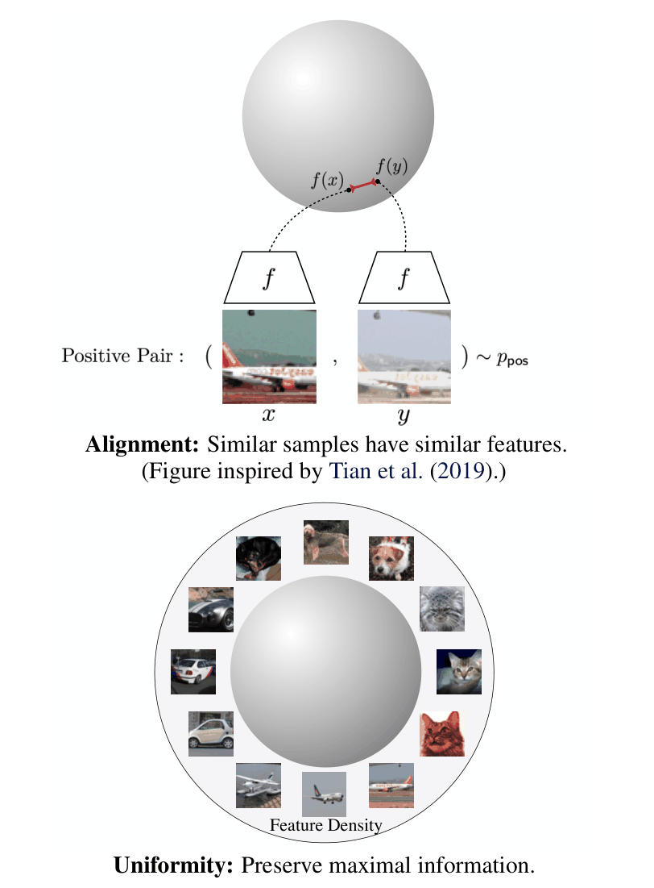
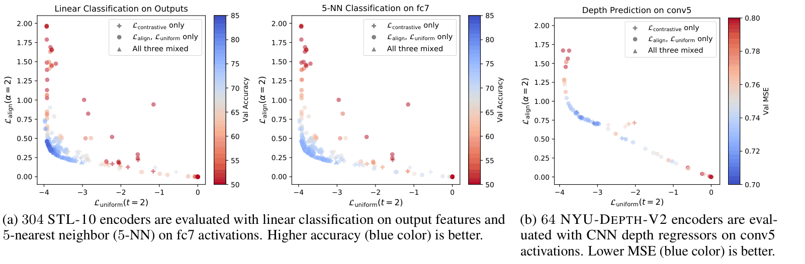
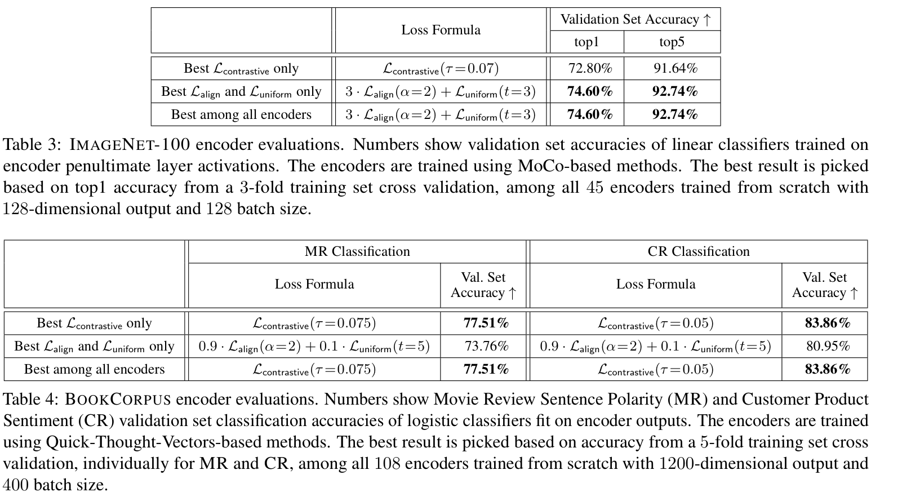
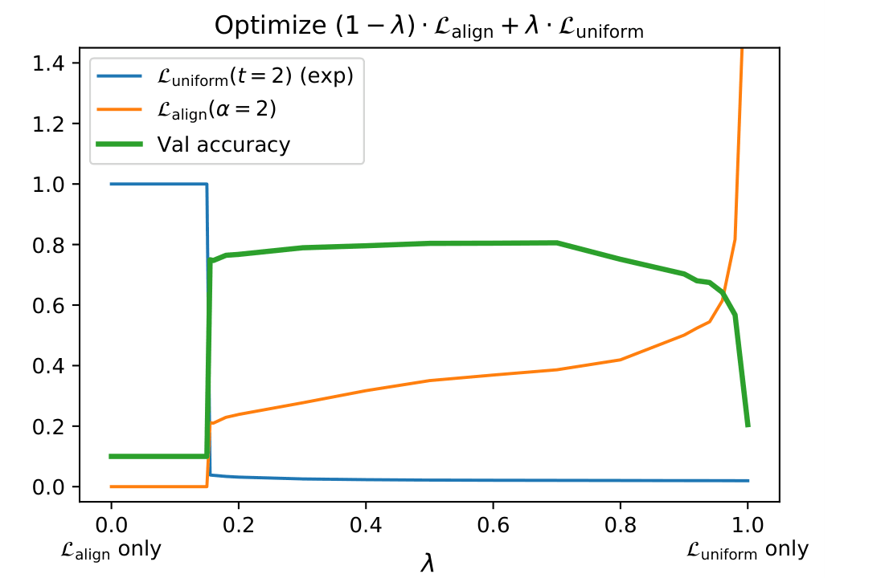
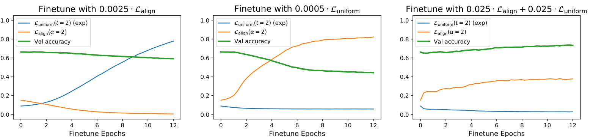

# Understanding Contrastive Representation Learning through Alignment and Uniformity on the Hypersphere 论文解读

## 论文基本信息

| 字段 | 内容 |
| --- | --- |
| 论文 | Understanding Contrastive Representation Learning through Alignment and Uniformity on the Hypersphere |
| 作者 | Tongzhou Wang、Phillip Isola |
| 机构 | MIT CSAIL |
| 首次发布 | 2020-05-20 |
| 本文阅读版本 | arXiv v10，2022-08-15，含理论证明与实验附录，共 41 页 |
| Venue | ICML 2020，PMLR 119，pp. 9929–9939 |
| 论文 | [arXiv 摘要与版本历史](https://arxiv.org/abs/2005.10242)、[v10 PDF](https://arxiv.org/pdf/2005.10242v10)、[PMLR 正式记录](https://proceedings.mlr.press/v119/wang20k.html) |
| 代码 | [Alignment / Uniformity 指标与 STL-10 示例](https://github.com/SsnL/align_uniform)、[MoCo 变体与复现模型](https://github.com/SsnL/moco_align_uniform) |

阅读版本很重要：v10 的变更记录指出，2020 年 11 月修正了 Theorem 1 的收敛速率，正确表述是 $O(M^{-1/2})$；2022 年又从 Figure 5 和 Table 8 中移除了两个额外使用其他正则项的 STL-10 encoder。以下使用修订版的表述与数值。

## TL;DR

对归一化到单位球面的表示，作者把好表示的两个目标显式化：**Alignment 让正样本对靠近；Uniformity 让整体特征分布充分铺开。** 前者学习正样本所定义的不变性，后者抑制所有样本挤在一起的退化解。论文的理论贡献，是分析一种标准对比损失本身：负样本数趋于无穷后，它分解出的两项分别偏好这两个性质，而不只是把它解释成某个互信息下界。（§3–4、Theorem 1）

作者还把两者做成可测量、可直接优化的损失。视觉实验支持它们具有诊断价值：STL-10 输出层线性分类从 80.46% 提高到 81.15%，ImageNet-100 从 72.80% 提高到 74.60%。但这不是“新损失全面取代 InfoNCE”的证据：BookCorpus 训练后的 MR/CR 分类中，直接优化的结果分别为 73.76% / 80.95%，低于对比损失的 77.51% / 83.86%；完整 ImageNet 的收益也只有约 0.19 个百分点。（Tables 1、3–5）

对今天的 Embedding 研发，最值得保留的是一套**观察空间几何与正样本关系的诊断方法**。两个指标不能代替检索评测，也不能脱离采样分布、特征维度和正样本质量单独排名；把它们用到文本检索或多模态双塔，还需要验证论文假设是否成立。

## 论文脑图

```markmap
# Alignment & Uniformity
## 问题
### 归一化对比损失究竟在优化什么
### 为什么只拉近正样本会坍塌
### 互信息下界不能充分解释实际表现
## 方法
### Alignment：正样本距离的期望
### Uniformity：球面上的高斯势能
### 无限负样本下的损失分解
### 用加权和直接训练表示
## 实验
### STL-10：线性与近邻分类
### NYU-DEPTH-V2：深度预测
### ImageNet-100 / ImageNet：MoCo 变体
### BookCorpus：MR / CR 分类
### 权重扫描与微调干预
## 结论
### 两个指标共同观察比单独观察更有用
### 部分视觉任务可直接优化并取得收益
### 文本任务未证明直接优化更优
## 局限
### 渐近性质不等于有限 batch 完全等价
### 最优分布结论不等于下游性能保证
### 直接优化仍有两两计算开销
### 跨模态与有偏采样需要重新验证
## 可复现要点
### 使用 v10 理论与修订数据
### 先做 L2 归一化
### 固定维度、t、采样与去对角线规则
### 区分 output、fc7 与 penultimate 特征
### 固定探针协议并做多随机种子验证
```

## 研究背景与问题定义

### 从“拉近、推远”推进到可以检验的命题

对比学习的直觉很简单：同一张图的两个增强版本应该相似，其他样本应该相对不相似。但这个说法没有回答几个问题：推远最终形成什么分布？为什么只拉近正样本不够？一个更紧的互信息下界为什么不一定给出更好的下游表示？论文尝试在单位球面的几何中回答这些问题。（§1–3）

设数据分布为 $p_{\mathrm{data}}$，正样本对分布为 $p_{\mathrm{pos}}$，编码器为

$$
f:\mathbb{R}^{n}\rightarrow\mathbb{S}^{m-1},\qquad \|f(x)\|_2=1.
$$

输入是样本及正样本构造规则，输出是 $m$ 维单位向量。图像任务用同一图片的两个独立随机增强构造正对；文本实验沿用 Quick-Thought 的相邻句子规则。下游评估通常冻结 encoder，再训练线性分类器、逻辑分类器或深度预测头。（§3、§5）

理论还要求正对分布对称，且正对的边缘分布与 $p_{\mathrm{data}}$ 一致。负样本在理论中独立来自该数据分布。这些条件决定了定理的适用范围：采用 query/document 不同分布的双塔、hard-negative mining 或类别重采样时，不能直接把原定理当作已经成立。

### 归一化决定了研究对象

单位球面上，内积与距离满足

$$
\|u-v\|_2^2=2-2u^\top v.
$$

因此，增大余弦相似度等价于缩小平方欧氏距离。去掉归一化后，模型还能通过放大范数改变 softmax 的尖锐程度；本文的几何解释不能原封不动移植过去。球面限制让“相似度如何分配”成为明确问题，却没有自动保证所有语义任务都适合均匀分布。（§3、§6）

## 核心方法

### 1. Alignment：度量正样本应该有多近

作者定义

$$
\mathcal{L}_{\mathrm{align}}(f;\alpha)
=\mathbb{E}_{(x,y)\sim p_{\mathrm{pos}}}
\left[\|f(x)-f(y)\|_2^{\alpha}\right],\qquad \alpha>0.
$$

常用 $\alpha=2$。它越小，正样本的平均距离越小；取零意味着几乎所有正对都得到相同表示。对图像增强，这鼓励忽略增强引入的变化；对相邻句子，它鼓励保留上下文相关信息，所学不变性取决于正样本如何定义。（§4.1.1）

这个指标不能单独优化到底。令所有输入都映射到同一个单位向量，就能得到完美的 Alignment，但完全失去区分能力。它告诉我们“正对是否接近”，没有告诉我们“其他样本是否仍可区分”。



原文 Figure 1 把这两个目标放在同一输出空间中：上方关注正样本之间的局部关系，下方关注特征总体如何占据球面。图中的“保留信息”是对均匀性的动机解释，不能据此推断语义信息已经被完整保存。

### 2. Uniformity：度量整体分布是否挤在一起

作者采用高斯势能核

$$
G_t(u,v)=\exp\left(-t\|u-v\|_2^2\right)
=\exp\left(2t u^\top v-2t\right),\qquad t>0,
$$

再定义

$$
\mathcal{L}_{\mathrm{uniform}}(f;t)
=\log\mathbb{E}_{x,y\overset{\mathrm{i.i.d.}}{\sim}p_{\mathrm{data}}}
\left[\exp\left(-t\|f(x)-f(y)\|_2^2\right)\right].
$$

这里的 $x,y$ 是独立数据样本，**不是专门构造的正样本对**。距离很近的点对贡献较大势能，最小化平均势能会抑制过度拥挤。损失非正，通常越负表示越均匀；完全坍塌时所有距离为零，损失为零，是最差端点。（§4.1.2、附录 A.1.1）

为什么不直接最大化平均平方距离？因为

$$
\mathbb{E}\|u-v\|_2^2=2-2\|\mathbb{E}u\|_2^2
$$

对独立单位向量成立，所以任何零均值分布都能把它最大化。把一半样本放在北极、另一半放在南极就满足条件，却远未铺满球面。高斯核检查的是更丰富的分布结构，不能简化为“向量均值为零”。（附录 A.2）

Proposition 1 证明：在球面全部 Borel 概率分布中，均匀表面积分布是该高斯势能的唯一最小化分布。Proposition 2 进一步说明，最小化有限点势能的点集，在点数趋于无穷时，其经验分布弱收敛到均匀分布。它们是分布层面的结论，不代表任意神经网络都能实现这个分布，也不代表有限个点之间的距离应该完全相等。

### 3. 对比损失的渐近分解

论文研究的对比损失可写成

$$
\mathcal{L}_{\mathrm{con}}(f;\tau,M)
=\mathbb{E}\left[
-\log\frac{\exp(f(x)^\top f(y)/\tau)}
{\exp(f(x)^\top f(y)/\tau)+\sum_{i=1}^{M}\exp(f(x_i^-)^\top f(y)/\tau)}
\right].
$$

其中 $(x,y)$ 为正对，$x_i^-$ 是独立负样本，$\tau>0$ 是温度。由正对对称性，也可以交换锚点角色。固定温度，当 $M\rightarrow\infty$，Theorem 1 给出

$$
\begin{aligned}
\mathcal{L}_{\infty}(f;\tau)
&:=\lim_{M\rightarrow\infty}
\left[\mathcal{L}_{\mathrm{con}}(f;\tau,M)-\log M\right]\\
&=-\frac{1}{\tau}\mathbb{E}_{(x,y)\sim p_{\mathrm{pos}}}
[f(x)^\top f(y)]\\
&\quad+\mathbb{E}_{x\sim p_{\mathrm{data}}}
\left[\log\mathbb{E}_{z\sim p_{\mathrm{data}}}
\exp(f(z)^\top f(x)/\tau)\right].
\end{aligned}
$$

减去 $\log M$ 是去掉随负样本数增长的偏移。第一项可以精确改写为

$$
-\frac{1}{\tau}\mathbb{E}[f(x)^\top f(y)]
=\frac{1}{2\tau}\mathcal{L}_{\mathrm{align}}(f;2)-\frac{1}{\tau}.
$$

因此第一项恰好偏好完美对齐；第二项在完美均匀 encoder 可实现时，以这些 encoder 为确切最优解。修订版同时给出损失值相对极限的绝对偏差速率 $O(M^{-1/2})$。这不是下游准确率或参数优化误差的收敛速率。（§4.2、附录 A.2）

证明的第一步可以这样理解：把负样本求和除以 $M$，由大数定律趋近分布期望；单位向量保证指数内积有界，帮助处理外层期望与极限。证明第二项的最优分布还需要附录中的势能与测度分析，不能仅凭“把点推远”的直觉替代。

### 4. 最容易误读的地方：相同最优分布不等于相同损失

记定理中的第二项为

$$
T(f)=\mathbb{E}_{x}\log\mathbb{E}_{z}
\exp(f(x)^\top f(z)/\tau).
$$

把外层期望与 $\log$ 交换后得到的是另一个量

$$
J(f)=\log\mathbb{E}_{x,z}
\exp(f(x)^\top f(z)/\tau)
=\frac{1}{\tau}+\mathcal{L}_{\mathrm{uniform}}
\left(f;\frac{1}{2\tau}\right).
$$

两者一般不相等；Jensen 不等式给出 $T(f)\leq J(f)$。论文证明它们在理想、可实现的均匀分布处具有相同最优分布，**没有证明任意 encoder 上的数值或梯度相等**。因此，不能写成“InfoNCE 严格等于 Alignment 加 Uniformity”。有限 batch 下差异还会受到采样方式影响。（§4.2、附录 A.2）

温度与高斯尺度的对应是 $t=1/(2\tau)$，但在直接优化时，作者把 $t$ 和两个损失的权重作为可调超参数；这并不恢复一般意义上的损失等价。

### 5. 直接训练与实现时的约束

最简单的训练目标为

$$
\mathcal{L}=a\mathcal{L}_{\mathrm{align}}(f;\alpha)
+b\mathcal{L}_{\mathrm{uniform}}(f;t).
$$

对一个包含两路正对特征 $X,Y$ 的 minibatch，Figure 6 的实现分别计算同一路特征内部的两两势能，再平均两路 Uniformity。官方实现使用 `torch.pdist`，只取不同索引间的无序点对，排除对角线。输入应先满足单位范数约束。

实际复用时需保留这些细节：

- **去对角线规则**：距离矩阵的对角线全为零，会给势能平均值加入固定的 1；小 batch 时影响尤其明显。
- **平均与对数顺序**：先对势能求均值再取对数。对距离直接求平均、或先取对数后平均，得到的不是同一个指标。
- **数值与计算规模**：大 $t$ 或低精度下可用 log-sum-exp 形式改善数值稳定性；所有两两距离仍需要约 $O(B^2m)$ 的运算。简单公式不等于线性计算成本。
- **队列方法**：MoCo 变体保留动量 encoder 与队列，Uniformity 可在 query 与队列之间计算，还可加入 query 内部点对；它不是简单删除队列。（附录 B.2）

前三项中的工程建议是基于公式的实现分析；论文未提供统一硬件条件下的训练吞吐、峰值显存或端到端加速比，不能据此声称它已经证实更省算力。

## 实验设置与主要结果

### 实验覆盖哪些任务

| 预训练数据 | 正样本规则 / 模型 | 下游评估 | 证据位置 |
| --- | --- | --- | --- |
| STL-10 | 图像的两个增强；AlexNet 系列 encoder | output / fc7 上的线性与 5-NN 分类 | Figure 5、Table 1、附录 B.1 |
| NYU-DEPTH-V2 | 两个图像增强；CNN encoder | conv5 / conv4 上训练深度预测 CNN，MSE 越低越好 | Figure 5、Table 2 |
| ImageNet-100 | 图像增强；ResNet-50、MoCo 变体 | 倒数第二层特征上的线性分类 | Figure 9a、Table 3 |
| ImageNet | 图像增强；ResNet-50、MoCo v2 变体 | 线性分类 top-1 | Table 5、附录 B.2.2 |
| BookCorpus | 相邻句子；Quick-Thought 变体、双向 GRU | MR / CR 情感二分类 | Figure 9b、Table 4、附录 B.3 |

作者扫描了 304 个 STL-10、64 个 NYU-DEPTH-V2、45 个 ImageNet-100 和 108 个 BookCorpus encoder，改变损失组合、温度、尺度、维度、batch size、训练时长等。这个广度适合观察指标关系，但不能把散点之间的全部差异都归因于某一个超参数。（§5）

### 两个指标共同观察，才能看到表示质量的变化



Figure 5 中，每个点是一个训练后的 encoder，横轴是 Uniformity、纵轴是 Alignment，颜色表示下游表现；两项任务都以蓝色为好。较好的模型集中在两个损失都较低的区域，支持联合诊断，但这张图本身不是“任何任务的准确率都能由两个标量唯一确定”的证明。

### 逐项核对主结果

下表取各表中的纯对比损失组与仅使用 Alignment + Uniformity 组；增减量由原表相减得到，准确率使用百分点。

| 数据 / 指标 | 仅对比损失 | 仅 Alignment + Uniformity | 差异与解读 | 来源 |
| --- | ---: | ---: | --- | --- |
| STL-10，output + linear ↑ | 80.46% | 81.15% | +0.69 个百分点 | Table 1 |
| STL-10，fc7 + linear ↑ | 83.89% | 84.43% | +0.54 个百分点 | Table 1 |
| NYU，conv5 深度 MSE ↓ | 0.7024 | 0.7014 | 降低 0.0010，幅度较小 | Table 2 |
| NYU，conv4 深度 MSE ↓ | 0.7575 | 0.7592 | 直接优化在此层反而更差 | Table 2 |
| ImageNet-100，top-1 ↑ | 72.80% | 74.60% | +1.80 个百分点 | Table 3 |
| ImageNet-100，top-5 ↑ | 91.64% | 92.74% | +1.10 个百分点 | Table 3 |
| MR 分类准确率 ↑ | 77.51% | 73.76% | −3.75 个百分点，文本结果不支持全面替代 | Table 4 |
| CR 分类准确率 ↑ | 83.86% | 80.95% | −2.91 个百分点 | Table 4 |
| ImageNet，MoCo v2 top-1 ↑ | 67.5% ± 0.1% | 67.69% | 约 +0.19 个百分点；新方法该表未给多次运行方差 | Table 5 |

STL-10 的两个直接优化权重为 $0.98\mathcal{L}_{\mathrm{align}}+0.96\mathcal{L}_{\mathrm{uniform}}$，$\alpha=t=2$。NYU 最优组合为 $0.75\mathcal{L}_{\mathrm{align}}+0.5\mathcal{L}_{\mathrm{uniform}}$，同样取 $\alpha=t=2$。ImageNet-100 和完整 ImageNet 使用 $3\mathcal{L}_{\mathrm{align}}+\mathcal{L}_{\mathrm{uniform}}$，$\alpha=2,t=3$。这些权重来自特定实验，不能视为跨任务的通用默认值。



Tables 3–4 放在一起尤其有价值：同一篇论文既展示直接优化在视觉上的收益，也保留了文本上的落后。BookCorpus 组最优直接优化使用 $0.9\mathcal{L}_{\mathrm{align}}+0.1\mathcal{L}_{\mathrm{uniform}}$、$\alpha=2,t=5$，仍不如纯对比损失。

选模协议也影响解释。Table 1 的主对比是在 150 个从头训练、128 维、batch 768 的候选中，用训练集五折交叉验证的 output 线性分类分数选 encoder；Table 2 使用 conv5 MSE 选模；Table 3 用三折交叉验证选 top-1，Table 4 分别为 MR 与 CR 选模。因此“best among all encoders”不是事后对每个展示列各取一次最大值。完整 ImageNet 的对比损失基线均值和标准差来自官方实现的五次运行，不能把 0.19 个百分点直接称为显著提升。

### 权重消融：只改善一个指标会发生什么



Figure 7 扫描 $(1-\lambda)\mathcal{L}_{\mathrm{align}}+\lambda\mathcal{L}_{\mathrm{uniform}}$。只强调 Alignment 时发生坍塌；只强调 Uniformity 也不能得到最佳分类表现，中间区域更好。注意蓝线绘制的是 $\exp(\mathcal{L}_{\mathrm{uniform}})$，而不是对数损失本身，不能直接拿纵轴值与 Figure 5 比较。

论文提到某些权重比例区间内表现相对稳定，但这个经验观察来自 STL-10 的具体设置，不是适用于任意数据分布的安全范围。

### 微调干预：比相关性更进一步，但仍有适用范围



Figure 8 从使用次优温度 $\tau=2.5$ 训练的 STL-10 encoder 出发：只优化其中一个指标，目标指标改善，但另一项与分类性能变差；同时优化两项，分类性能提高。相比静态散点，这提供了干预证据；不过它仍是特定初始化、学习率和数据上的实验，没有证明所有下游任务都服从同一因果规律。

### 文本结果应如何解释

Quick-Thought 原方法有两个 encoder，使用相邻句子，并非标准的独立同分布负采样方案；原方法训练时也没有按本文统一设置进行 L2 归一化。作者为比较引入了相应变体。因此，Table 4 的落后不能简单归因为“Uniformity 对文本无效”，也不能反过来用 Figure 9 的相关性宣称新目标已胜过文本对比学习。（§5、附录 B.3）

另一个复现边界是 BookCorpus 的数据版本：作者重新收集的训练集包含 52,799,513 个句子，原 Quick-Thought 使用 45,786,400 个；二者验证集均为 50,000 句。复现应先明确语料版本，不能只记录同一个数据集名称。

## 当前工作 vs Related Work

| 方法 | 核心思路 | 主要假设 / 设置 | 本文中的证据或关系 | 局限或代价 |
| --- | --- | --- | --- | --- |
| 本文 Alignment + Uniformity | 分别度量正样本关系与球面边缘分布，可直接优化 | 单位范数；正对构造合理；理论要求匹配边缘与独立负采样 | 视觉任务部分改善；文本 MR/CR 落后 | 两项要平衡；没有通用下游风险保证；仍有两两计算 |
| [SimCLR](https://arxiv.org/abs/2002.05709) / 标准归一化对比学习 | 用温度 softmax 区分正对与负样本 | 图像增强与 minibatch 负样本 | 论文用于讨论相近的对比目标；并未提供完整 SimCLR 系统逐项同预算复现 | 不应把本文主表数字标成 SimCLR 的直接胜负 |
| [MoCo](https://arxiv.org/abs/1911.05722)、[MoCo v2](https://arxiv.org/abs/2003.04297) | 动量 encoder 与队列提供大规模对比字典 | 队列特征与当前 encoder 存在时间差 | Tables 3、5 保留框架并修改目标，ImageNet-100 +1.80 个百分点 | 仍需队列、动量更新；全 ImageNet 改善幅度小 |
| [Quick-Thought Vectors](https://arxiv.org/abs/1803.02893) | 用上下文句子识别学习句表示 | 相邻句子正对、双 encoder | Table 4 的对比损失组在 MR/CR 上更好 | 相邻关系不等于语义等价；与单 encoder 理论设定不同 |
| InfoMax 解释 | 最大化两视图之间的互信息或其下界 | 依赖所用估计器与下界 | 本文改为分析具体损失的几何性质 | 下界更紧不保证下游表示更好；几何分析也不等于完成全部语义解释 |

这张表比较的是方法关系与本文证据范围。除主表明确给出的组别外，不补写跨论文、跨训练预算的数值排名。

## 启发、局限与可复现要点

### 对 Embedding 训练最直接的启发

把 Alignment、Uniformity 作为训练与验证仪表盘很有价值。如果正对越来越近、随机样本却越来越挤，可能存在过强对齐或坍塌倾向；如果整体越来越均匀、正对关系却变差，可能把增强差异或语义近邻也推散了。但这只是诊断线索，最终应与目标检索指标、错误案例和数据分组一起判断。

以下是面向文本与多模态检索的延伸建议，并非原论文已经验证的结论：

- 同时记录正对距离、随机点对 Uniformity、同类但非标注正对的距离，区分全局分散与语义邻域破坏。
- 双塔中分别测 query 分布、document 分布和跨塔正对；将两塔混成一个分布可能掩盖各自问题。
- 固定抽样集与维度再比较 checkpoint；按任务、语言、模态和头尾类别分别观察。
- 新损失只作为受控实验变量，用固定候选池上的 Recall@K、nDCG 等目标指标决策，防止把几何指标本身当成刷榜目标。

### 四个不能省略的局限

**理论不直接保证下游语义性能。** 定理说明损失与分布性质的关系，没有引入任意下游标签并证明风险一定下降。“均匀分布具有最大球面微分熵”与“保留全部有用语义”也不是同一命题。

**完美对齐与完美均匀可能不能同时实现。** 对有限原始样本，若所有增强视图都被完美对齐，输出只剩有限个点，不能等于连续球面均匀分布。学习实际上是在网络能力、数据结构和两个目标之间折中。（§4.2）

**采样分布决定测到的几何。** hard negatives、有偏类别采样和重复数据会改变势能平均值的含义。在多模态、有层次语义和长尾数据中，强求某个混合分布全局均匀是否合适，需要实证，而非从本文直接推出。

**平均指标会掩盖局部失误。** 两个模型可能具有接近的全局均值，但在稀有概念、跨语言对齐或特定负例上表现不同。指标相关性不等于可用这两个标量替换完整评测。

### 复现时优先固定什么

| 项目 | 原文设置或需要记录的内容 |
| --- | --- |
| 版本 | 使用 v10；避免旧版收敛速率与已移除的 STL-10 点 |
| 特征 | L2 归一化；区分用于训练的输出层与用于评测的中间层 |
| 指标 | $\alpha$、$t$、采样规模、是否去对角线、先 log 还是先平均 |
| STL-10 主表 | 128 维、batch 768；从头训练候选的交叉验证选模 |
| 图像训练 | 附录 B.1 默认 SGD、momentum 0.9、weight decay 0.0001；CIFAR/STL 默认 200 epochs，具体行的覆盖设置见附表 |
| ImageNet-100 | 附录 B.2.1：ResNet-50、batch 128、240 epochs、EMA 0.999；类别清单见 Table 7 |
| 完整 ImageNet | 附录 B.2.2：ResNet-50、batch 256、200 epochs、128 维、队列 65536、EMA 0.999 |
| 文本 | 语料重建版本、相邻句子采样、双 encoder、是否训练时归一化、batch 400 与 1200 维主表设置 |
| 性能可信度 | 重复运行、方差、统一探针训练预算；避免把 best-of-sweep 当作任意配置的结果 |

### Uniformity 的绝对数值没有跨设置通用阈值

附录 A.1.1 给出 $m$ 维单位向量的总体分布下界：

$$
\mathcal{L}_{\mathrm{uniform}}^{\star}(m,t)
=-2t+\log\,{}_0F_1\left(;\frac{m}{2};t^2\right).
$$

其中 ${}_0F_1$ 是超几何极限函数；固定 $t$、维度增大时，下界趋向 $-2t$。所以常见的 $t=2$ 与“接近 −4”只在适当高维等条件下有解释，不能把 −4 当作所有维度、所有估计方式的严格有限样本下界。

尤其是去掉对角线的 `pdist` 估计，并不满足与总体分布完全相同的有限样本下界；附录专门讨论了这种区别。把一个小 batch 的值低于总体下界解释为“超越理论最优”，是估计对象混淆。

### 值得做的下一步实验

如果将这篇论文用于新的 Embedding 训练，先保留既有对比训练方案，只加入固定验证样本上的两个诊断指标。随后在同样的数据、batch、训练预算下，比较基线、额外 Uniformity 正则、直接 Alignment + Uniformity 三组，扫描权重与尺度，并检查语义近邻是否受损。最终报告应同时给出检索指标、分组表现、显存和吞吐；这些实验是本文带来的研究建议，本次阅读没有运行新的训练实验。

## 再读一遍路线

1. 先看 Figure 1 与 Figure 7，建立局部对齐、全局分散和两端退化的直觉。
2. 读 §3 的分布假设，再推一遍 §4.2 的 Theorem 1，检查 $\log$ 和两层期望的位置。
3. 对照附录 A.2，确认为什么两个 Uniformity 相关目标共享最优分布，却不共享任意位置的梯度。
4. 连读 Tables 1–5，特别保留 NYU conv4、MR/CR 的反例与 ImageNet 的小幅收益。
5. 看 Figure 8，区分相关性扫描与干预实验，再到附录 B 核对层、队列、归一化和探针协议。
6. 最后读附录 A.1.1，把维度依赖、总体下界与去对角线估计的差异弄清楚，再考虑把指标接入自己的训练监控。

# 深度 Q&A

## Q1：为什么不能只用“最大化互信息”解释这类方法？

互信息视角提供动机，但某个可计算下界的优化效果，还受估计器、负采样、网络结构和正样本构造影响。论文指出，更紧的下界不一定产生更好的下游表示。本文的替代视角是直接研究特定对比损失：在归一化条件下，它如何同时塑造正样本关系与边缘分布，而不是否认互信息可能有用。（§2–4）

## Q2：Alignment 是否就是把同类样本全部聚到一个中心？

不是。它只关心 $p_{\mathrm{pos}}$ 定义的正对，未显式读取类别标签。两个同类样本若从未构成正对，损失没有直接要求它们相同。反过来，若正对规则把语义不等价的输入连起来，过强对齐会抹掉有用差异；正样本质量决定了“不变性”是否符合任务。

## Q3：Uniformity 是否要求任何两条向量都正交？

不要求。目标是概率分布在球面上的覆盖，有限点之间会存在各种夹角。维度固定且样本很多时，也不可能让所有向量两两正交。高维随机单位向量常呈现接近正交的现象，但这不是损失对每一对样本强制施加的等式约束。

## Q4：负样本无限多时，就能把 InfoNCE 换成两项加权和且训练完全相同吗？

不能。第一项与 $\alpha=2$ 的 Alignment 确实只差常数与系数；第二项是 $\mathbb{E}\log\mathbb{E}$，所提 Uniformity 则是 $\log\mathbb{E}\mathbb{E}$。共享理想最优分布不意味着共享梯度和训练轨迹。有限 batch、网络可实现性和队列时滞还会进一步影响实际行为。（Theorem 1、附录 A.2）

## Q5：论文是否证明负样本越多，下游任务一定越好？

没有。$O(M^{-1/2})$ 描述固定条件下对比损失值逼近其极限形式的速率，不是下游准确率的单调定理。作者引用了大负样本量有益的经验研究，但不能将这种经验扩张到存在假负例、重复数据或有偏采样的任意检索任务。

## Q6：没有很多负样本时，理论是否完全失效？

附录给出单负样本的 Theorem 2：如果同时完美对齐、完美均匀的 encoder 存在，那么它们是 $M=1$ 时的确切最小化解。这个存在性条件比 Theorem 1 的两项分析更强，现实有限数据中往往难以同时满足；不能把它用作任意小 batch 设置的性能保证。

## Q7：Figure 5 的两个低指标是否足以预测某个模型一定更好？

不足。它是多个训练设置中的经验关系，且下游评估局限于文中任务。全局平均值无法编码所有局部语义关系，两个几何性质也没有把标签、候选池或任务代价写进定义。模型选型应以目标任务为准，把这两个指标用于解释差异与发现异常。

## Q8：为什么表格里的视觉收益不能直接推广到文本检索？

图像增强正对与相邻句子正对有不同含义，CNN 与双向 GRU 的结构也不同，分类探针和检索排序更是不同评测。论文自身的 Table 4 已展示 MR/CR 中直接优化较差。可以推广的是研究问题和诊断方法，能否提升检索效果需要新的受控实验。

## Q9：直接优化是否消除了负样本与计算瓶颈？

它可以不再使用同样形式的正负 softmax 分类，但 Uniformity 仍要采样随机点对并计算排斥势能。完整 batch 内两两计算是二次规模，MoCo 版本仍使用队列。论文没有报告足以证明统一端到端成本优势的吞吐与显存对照，因此“公式更短”不能写成“训练一定更快”。

## Q10：如何比较不同维度或不同 batch 的 Uniformity？

首先固定 $t$ 和估计方式，并记录是否包含自配对；再考虑维度对应的总体最优值和采样波动。最稳妥的 checkpoint 对比使用同维度、同一验证抽样集和同样的去对角线规则。若跨维度，可补充与各维度均匀参考分布的差值，但仍要保留原始值与目标任务指标。（附录 A.1.1）

## Q11：怎样把它用在图文双塔，而不误用单分布定理？

可分别检查图像边缘、文本边缘的 Uniformity，以及跨模态配对的 Alignment，再按任务分组分析。单 encoder、对称正对与匹配边缘的假设不能直接覆盖不同输入分布的双塔。是否共享均匀性目标、是否对两塔使用不同权重，以及多对多正样本如何处理，都是延伸问题；原论文没有完成这些验证。

## Q12：这篇论文留下的核心开放问题是什么？

从“球面几何有利”走到“任务语义被保留”之间仍有距离：数据中哪些变化应不变，哪些近邻应该保留，长尾与层次结构是否需要非均匀先验？本文给出可测量的两个轴和扎实的渐近联系，为这些问题提供了实验工具，但没有给出适用于所有表示学习任务的单一最优几何。
